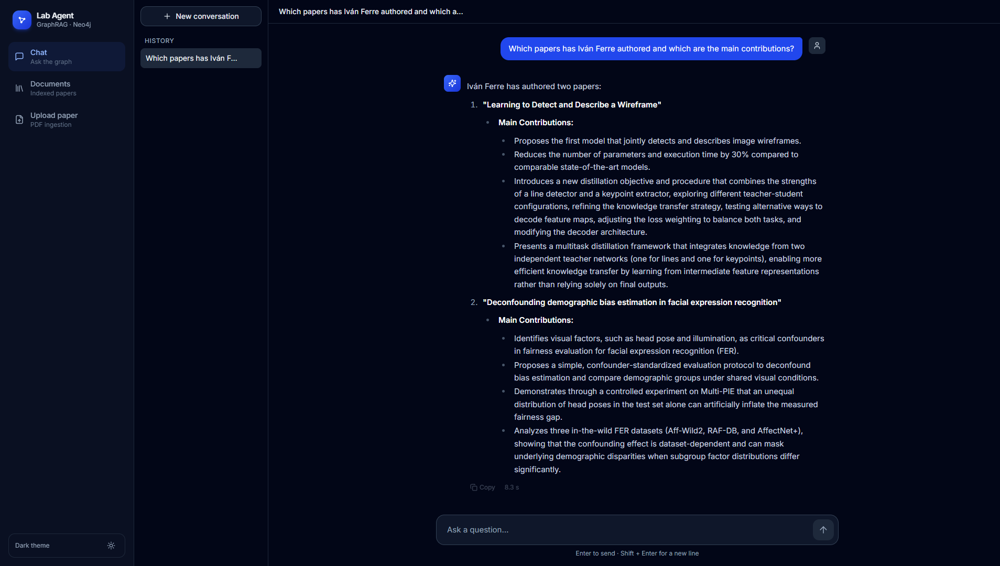
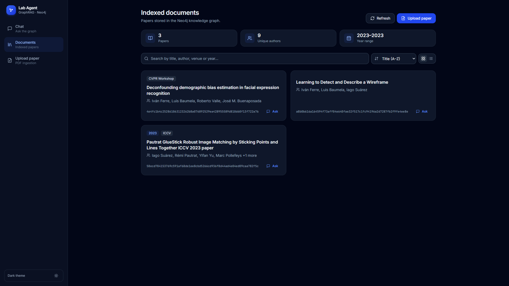
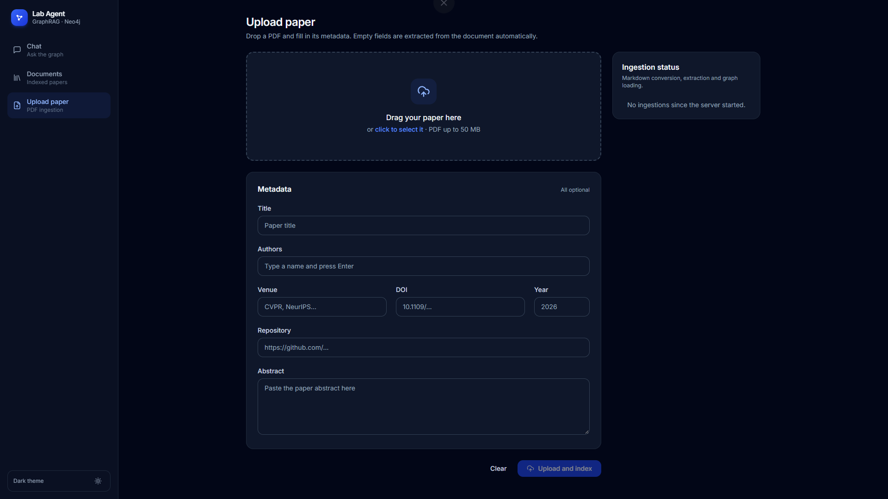
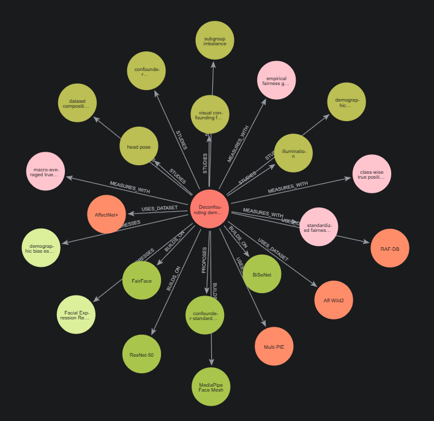

# Lab Agent: GraphRAG over research papers

[](https://github.com/iferfra/lab-agent/actions/workflows/ci.yml)

An assistant that answers questions about scientific papers by combining a
**knowledge graph** (who wrote what, which methods, datasets and metrics each
paper uses) with **semantic search** over the papers' text.

You upload a PDF, the system turns it into a Neo4j graph plus searchable text
chunks, and a LangGraph agent decides, question by question, whether to query
the graph, search the text, or both. An evaluation suite measures how well it
answers and whether the graph actually helps compared with plain vector search.

```
            ┌────────────── Frontend (React, nginx) ──────────────┐
            │      Chat        Documents        Upload PDF        │
            └─────────────────────────┬───────────────────────────┘
                                      │ /api
            ┌─────────────────────────▼───────────────────────────┐
            │                   API (FastAPI)                     │
            │   POST /chat        GET /documents   POST /ingest   │
            └───────┬──────────────────────────────────┬──────────┘
                    │                                  │ background worker
          ┌─────────▼─────────┐              ┌─────────▼──────────┐
          │  LangGraph agent  │              │ Ingestion pipeline │
          │  (3 tools)        │              │ PDF → graph        │
          └─────────┬─────────┘              └─────────┬──────────┘
                    │                                  │
            ┌───────▼──────────────────────────────────▼───────┐
            │   Neo4j: knowledge graph + vector index          │
            └──────────────────────────────────────────────────┘
                   LLMs and embeddings: Amazon Bedrock
```

## Screenshots

Answers combine the graph (which papers an author wrote) with the papers' text
(their contributions):



| Indexed papers | Upload with optional metadata |
|---|---|
|  |  |

A paper and its entities in Neo4j: the method it proposes, the methods it
builds on, its datasets, metrics and the concepts it studies.

<p align="center">
  
</p>

## Contents

- [Screenshots](#screenshots)
- [Repository layout](#repository-layout)
- [How it works](#how-it-works)
  - [Ingestion](#ingestion)
  - [Knowledge graph](#knowledge-graph)
  - [Agent](#agent)
  - [API](#api)
  - [Frontend](#frontend)
  - [Evaluation](#evaluation)
- [Results](#results)
- [Getting started](#getting-started)
- [Development](#development)
- [Costs](#costs)
- [Known limitations](#known-limitations)

## Repository layout

```
app/                  FastAPI application
  main.py             startup: Neo4j connection, schema, ingestion worker
  routers/            HTTP endpoints: chat, documents, ingest
src/
  ingestion.py        PDF → Markdown → sections → chunks; background queue
  graph/
    graph.py          LLM extraction and writing the paper to Neo4j
    ontology.py       the graph schema (node labels and relationships)
    extraction_schemas.py  Pydantic models the LLM fills in
    validation.py     checks that discard hallucinated entities
  agent/
    workflow.py       the LangGraph state machine
    nodes.py          system prompt, model call, routing, forced final answer
    tools.py          the three retrieval tools
    llm.py            agent model and embeddings
frontend/             React + Vite + Tailwind single-page app, served by nginx
eval/                 benchmark: dataset, agent runs, metrics, LLM judge, report
  dataset/            sources.json, known_gaps.json, questions.jsonl
  runs/               one folder per evaluated run
tests/                unit tests (no LLM or database calls)
docker-compose.yml    API + frontend containers
```

## How it works

### Ingestion

Uploading a PDF (`POST /ingest/paper`) saves it under its SHA-256 hash, so the
same file is never indexed twice, and puts it on a queue. A background worker
processes the queue in a separate thread so the API stays responsive.
`src/ingestion.py` and `src/graph/graph.py` then:

1. **Convert the PDF to Markdown** with `pymupdf4llm`, which keeps headings
   and tables.
2. **Split by sections, then by size.** `MarkdownHeaderTextSplitter` cuts at
   `##` and `###` headings, and long sections are split into chunks of about
   1,200 characters. Each chunk remembers its section (e.g.
   `4. Experiments > 4.2 Quantitative Results`). The **References** section is
   dropped: it only added noise and cost.
3. **Read the whole paper once** (`PAPER_LLM`, Claude Sonnet 4.6). One call
   extracts the metadata (title, authors, venue, code repository) and the
   paper's main entities: the method it proposes, the methods it builds on or
   compares with, and its tasks, datasets, metrics and central concepts. Each
   entity gets a canonical name plus aliases (`FER` → *facial expression
   recognition*, `our model` → the proposed method).
4. **Find the entities each chunk mentions** (`GRAPH_LLM`, Nova 2 Lite, up to 4
   calls in parallel). The model gets the canonical list, so every spelling of
   an entity ends up in the same node.
5. **Validate.** An entity is kept only if its name or an alias appears in the
   paper, and a mention only if its evidence sentence appears verbatim in the
   chunk. Math symbols (`d`, `θ_1`) are rejected, and a year or DOI is dropped
   if the paper does not state it.
6. **Embed** each chunk with Titan Text Embeddings v2. The embedded text is
   prefixed with `<paper title> > <section>` so a chunk such as "we train for
   35 epochs" still matches questions about that paper.
7. **Write** the paper, its entities, the chunks with their embeddings and all
   relationships to Neo4j. If anything fails, the partly written paper is
   deleted so it can be uploaded again.

The tokens spent are stored on the `Paper` node (`ingestion_input_tokens`,
`ingestion_output_tokens`).

### Knowledge graph

```
(Author)-[:WROTE]->(Paper)<-[:PART_OF]-(Document)-[:MENTIONS]->(entity)

(Paper)-[:PROPOSES]->(Method)        its own contribution
(Paper)-[:BUILDS_ON]->(Method)       existing methods it reuses
(Paper)-[:COMPARES_WITH]->(Method)   baselines in its experiments
(Paper)-[:ADDRESSES]->(Task)
(Paper)-[:USES_DATASET]->(Dataset)
(Paper)-[:MEASURES_WITH]->(Metric)
(Paper)-[:STUDIES]->(Concept)
```

- `Document` nodes are the text chunks (`text`, `section`, `embedding`), stored
  in the vector index `documentVectorIndex`.
- Entities have a `name` and a list of `aliases`.
- All entity relationships start at the `Paper`. This keeps the schema small,
  so the LLM that writes Cypher queries gets it right, and it maps directly to
  the questions users ask ("which datasets does paper X use?").

The schema lives in `src/graph/ontology.py`.

### Agent

A LangGraph state machine (`src/agent/workflow.py`) running `AGENT_LLM` (Nova 2
Lite):

```
START → agent ──tool calls──→ tools ──→ agent → … → END
          └── tool budget exhausted ──→ final_answer → END
```

The model chooses among three tools (`src/agent/tools.py`):

| Tool | What it does | Good for |
|---|---|---|
| `search_knowledge_graph` | An LLM writes a Cypher query from the question (LangChain `GraphCypherQAChain`) and returns the raw rows | Authorship and relationships across papers |
| `find_paper_entities` | A fixed Cypher query that lists a paper's methods, datasets, metrics… with their relationship (`PROPOSES`, `USES_DATASET`…) and how many chunks mention them | "Which datasets does X use?", "Which paper uses HPatches?" |
| `search_chunks_semantically` | Vector search shortlists 50 chunks (optionally from one paper, `paper_title`), and a reranker (Cohere Rerank 3.5) keeps the 10 most relevant, with their section | Details, results and claims from the text |

The agent can make at most 5 model calls. If it still wants a tool after that,
`final_answer` makes it answer with the evidence gathered so far, instead of
ending with an empty message.

### API

| Endpoint | Description |
|---|---|
| `POST /chat` | `{"query": "..."}` → `{"query", "response"}`. Runs the agent; each request is independent (no conversation memory). |
| `GET /documents` | Indexed papers: id, title, year, venue, authors. |
| `POST /ingest/paper` | Multipart form: `file` (PDF) plus optional `paper_title`, `authors` (repeat the field for each one), `doi`, `venue`, `year`, `repository_link`. Values you send override the extracted ones. |
| `GET /ingest/status` | Status of each upload: `pending`, `processing`, `completed` or `failed`. |

Interactive documentation: `http://localhost:8000/docs`.

### Frontend

A React + Vite + Tailwind app (`frontend/`) with three pages:

- **Chat:** conversations rendered as Markdown (tables, code highlighting, LaTeX
  formulas), saved in the browser's `localStorage`.
- **Documents:** the indexed papers.
- **Upload:** drag-and-drop a PDF, optionally fill in its metadata, and follow
  the ingestion status.

In production nginx serves the built app and proxies `/api/*` to the API
(`API_UPSTREAM`). In development Vite's dev server does the same.

### Evaluation

`eval/` answers two questions: how good are the answers, and does the graph
help compared with vector search alone?

```
knowledge graph ──sources──▶ sources.json ──generate──▶ candidates.jsonl
                                 ▲                          │ validate + human review
                       known_gaps.json                      ▼
                                                     questions.jsonl
                                                            │ run (agent)
                                                            ▼
                                           runs/<run>/results.jsonl
                                                            │ evaluate
                                                            ▼
                                     scores.jsonl + summary.json ──report──▶ results.md
```

| Step | Command |
|---|---|
| Build the sources from the graph | `uv run python -m eval.sources` |
| Generate candidate questions | `uv run python -m eval.dataset generate --category hybrid -n 6` |
| Validate them | `uv run python -m eval.dataset validate` |
| Run the agent | `uv run python -m eval.run --variant hybrid --name my_run` |
| Score a run | `uv run python -m eval.evaluate my_run` (add `--no-judge` for the free metrics only) |
| Compare runs | `uv run python -m eval.report` → `eval/results.md` |

**Dataset.** `sources.json` is built from the graph by `eval/sources.py`:

- **Graph facts:** sentences such as *"'X' uses the datasets A, B and C"*.
- **Chunks:** for each paper, the chunks that mention the most of its main
  entities, at most one per section.
- **Known gaps:** things the papers do *not* say, written by hand in
  `known_gaps.json`.

An LLM writes questions from them in four categories:

| Category | Needs | Example |
|---|---|---|
| `graph` | graph facts | Which authors wrote both papers? |
| `semantic` | a text chunk | How does the proposed protocol work? |
| `hybrid` | both | A result on one of the datasets the graph links to a paper |
| `unanswerable` | a known gap | What GPU memory did training use? |

`validate` only catches structural problems (unknown source ids, a hybrid
question without graph evidence…), so read `questions.jsonl` before trusting
it.

**Metrics.** Everything that can be computed is computed. The LLM judge
(`EVALUATION_LLM`) is used only where reading comprehension is needed, and it
makes one yes/no decision per fact or claim instead of giving a global score.

| Metric | How | Question it answers |
|---|---|---|
| Fact recall | judge: is each required fact in the answer? | Is the answer correct and complete? |
| Faithfulness | judge: split the answer into claims, check each one against the retrieved context | Does the agent make things up? |
| Abstention | judge, unanswerable questions only | Does it say "I don't know" when it should? |
| Context recall | code: evidence chunk ids ∩ retrieved chunk ids | Does retrieval find the right passages? |
| Source accuracy | code: sources used (graph, text) == sources the category needs | Does it pick graph vs. text correctly? |
| Latency, tokens | measured during the run | What does an answer cost? |

**Ablation.** `--variant` sets which tools the agent gets, so the same
questions measure what each retrieval path adds: `hybrid` (all three tools),
`vector` (text search only) or `graph` (the two graph tools).

**When the chunking changes.** Chunk ids are hashes of the chunk text. If the
papers are re-ingested with a different chunking, run
`uv run python -m eval.remap_chunks` (add `--write` to apply it). It points the
dataset and earlier runs at the new chunks with the most overlapping text.
Alternatively, rebuild the sources and regenerate the questions. `evaluate`
refuses to score a run that was made with different questions.

## Getting started

### Prerequisites

- **Docker** with Docker Compose.
- **A Neo4j Aura instance.** The free tier is enough (see below).
- **Amazon Bedrock** in `us-east-1` with access to Amazon Nova Lite, Amazon
  Nova 2 Lite, Titan Text Embeddings v2 and Claude Sonnet 4.6, plus a Bedrock
  API key (bearer token). Cohere Rerank 3.5 is optional (see `RERANK_MODEL`).

### Create the Neo4j Aura database

The knowledge graph and the vector index live in
[Neo4j Aura](https://neo4j.com/product/auradb/), Neo4j's managed cloud database.
The free tier holds far more than this project needs.

1. Sign up at [console.neo4j.io](https://console.neo4j.io).
2. Create a new instance and choose **AuraDB Free**.
3. When the instance is created, **download the credentials file**. It holds
   the password, and Aura shows it only once.
4. Wait until the instance status is *Running* (a minute or two).

The file contains `NEO4J_URI`, `NEO4J_USERNAME`, `NEO4J_PASSWORD` and, on
recent instances, `NEO4J_DATABASE`: these are the values `.env` needs. On
startup the API creates the constraints and the vector index it uses. Free
instances are paused after some days without use; resume them from the console.

To look at the graph, open the instance in the Aura console and use **Query**,
for example with `MATCH (p:Paper)-[r]->(e) RETURN p, r, e`.

### Configuration

```bash
cp .env.example .env
```

Fill in the four `NEO4J_*` values from the Aura credentials file and
`AWS_BEARER_TOKEN_BEDROCK`. The rest have working defaults.

| Variable | Meaning |
|---|---|
| `NEO4J_URI`, `NEO4J_USERNAME`, `NEO4J_PASSWORD`, `NEO4J_DATABASE` | Neo4j Aura connection, from the credentials file |
| `AWS_BEARER_TOKEN_BEDROCK` | Bedrock API key; it expires, so renew it when calls fail with `Bearer Token has expired` |
| `AGENT_LLM` | Model the agent reasons with |
| `PAPER_LLM` | Model that reads each whole paper at ingestion (one call per paper) |
| `GRAPH_LLM` | Model that finds the entities of each chunk (one call per chunk) |
| `EVALUATION_LLM` | Model that generates benchmark questions and judges answers |
| `RERANK_MODEL` | Reranker for text search (`cohere.rerank-v3-5:0`). Leave it empty to rank chunks by vector similarity only |
| `CHUNK_SIZE`, `CHUNK_OVERLAP` | Chunking in characters (changing them changes chunk ids, see above) |
| `DATA_DIR` | Where uploaded PDFs and their Markdown are stored |

### Run with Docker

```bash
docker compose up --build
```

| Service | URL |
|---|---|
| Frontend | http://localhost:10000 |
| API docs | http://localhost:8000/docs |

Uploaded PDFs are kept in the `lab_data` Docker volume and the graph in Aura,
so both survive `docker compose down`.

Then upload a PDF on the **Upload** page, wait until its status is
*completed* (about a minute for a 15-page paper), and ask about it in **Chat**.

### Index a paper from the command line

```bash
curl -F "file=@paper.pdf;type=application/pdf" -F "year=2026" \
     http://localhost:8000/ingest/paper
curl http://localhost:8000/ingest/status
```

## Development

Requires [uv](https://docs.astral.sh/uv/) and Node.js 22.

```bash
uv sync                                  # Python dependencies
uv run fastapi dev app/main.py           # API with auto-reload on :8000

cd frontend && npm install && npm run dev   # frontend on :5173, proxies /api to :8000
```

Tests and linting (no LLM or database calls):

```bash
uv run pytest
uv run ruff check . && uv run ruff format --check .
```

The same checks run on GitHub Actions on every push and pull request
(`.github/workflows/ci.yml`): lint and tests, a type-checked frontend build, and
a build of both Docker images. They need no secrets.

The `eval` and `src` modules are run as packages from the repository root
(`uv run python -m eval.run …`), not as scripts.

## Results

The same 17 questions, answered by the agent with different retrieval setups
(`eval/results.md`):

| Run | Tools | Fact recall | Faithfulness | Abstention | Context recall | Latency (median) | Tokens / question |
|---|---|---|---|---|---|---|---|
| **hybrid + reranker** | graph + text | **100%** | **100%** | 100% | **75%** | 5.0 s | 8,987 |
| hybrid | graph + text | 98% | 100% | 100% | 56% | 4.6 s | 8,976 |
| vector | text only | 91% | 99% | 100% | 50% | 3.3 s | 7,673 |
| graph | graph only | 75% | 87% | 100% | — | 9.9 s | 12,495 |

Fact recall by question category:

| Run | graph (5) | semantic (6) | hybrid (2) |
|---|---|---|---|
| hybrid + reranker | 100% | 100% | 100% |
| hybrid | 95% | 100% | 100% |
| vector | 76% | 100% | 100% |
| graph | 95% | 67% | 50% |

What the comparison shows:

- **The two retrieval paths are complementary, and the hybrid agent gets the
  best of both.** Text search alone fails questions that need a complete list,
  such as "which datasets and metrics does the paper use?": it answers from
  whichever chunks it happens to retrieve. The graph alone cannot answer
  questions about details in the text.
- **Without the text, the agent invents more.** The graph-only variant has 87%
  faithfulness, the only clear drop. Missing the details, it fills the gaps
  with claims it cannot support.
- **The graph alone is the most expensive variant**, not the cheapest. With no
  text to fall back on, the agent retries Cypher queries: 9.9 s and about 12k
  tokens per question. The hybrid agent costs about 17% more tokens than
  text-only search.
- **The reranker fixes most retrieval misses.** Vector search shortlists 50
  chunks and Cohere Rerank 3.5 keeps the 10 best. Context recall rises from 56%
  to 75% (83% on semantic questions), at the same token cost, 0.4 s more and
  about $0.003 per question.
- **Source accuracy is not comparable across variants.** A single-tool variant
  cannot use the sources it does not have, so it is left out of the table. For
  the hybrid agent it is 65–71%; most misses are semantic questions where it
  also queried the graph.
- **The benchmark is small, and the judge is noisy.** With 17 questions one
  question is 6 points, and the hybrid category has only two. Re-judging the
  same answer has changed its score, so read differences of one or two
  questions as noise. The direction of the results is clear, but not the exact
  size of the gaps.

## Costs

Approximate Bedrock costs measured on this project's two papers (Bedrock
prices change, so check them before running large jobs):

| Operation | Approximate cost |
|---|---|
| Ingest one paper (~40 chunks) | $0.10–0.15, most of it the Claude Sonnet call |
| Generate a full question set | ~$0.03 |
| Agent run over the benchmark | a few cents (reranking adds about $0.05) |
| Judge a run | ~$0.01–0.02 |
| `evaluate --no-judge`, tests, `sources`, `report` | free |

## Known limitations

- **Small corpus.** Two papers and about twenty questions: differences of a few
  points between runs are noise, not signal.
- **Context recall is a lower bound.** Another chunk may contain the same
  information as the one a question was written from.
- **Same model family.** The judge, the question generator and the agent are all
  Amazon Nova models, which can bias the judge towards the agent's style.
  Spot-check the judge's `notes` in `scores.jsonl`.
- **LLM extraction is not deterministic.** Re-ingesting a paper can change some
  entities or the relationship they get (e.g. a baseline listed under
  `BUILDS_ON`).
- **No conversation memory.** `/chat` answers each message on its own; the
  frontend keeps the history only for display.
- In the single-tool evaluation variants the system prompt still describes all
  the tools; the model simply cannot call the missing ones.
